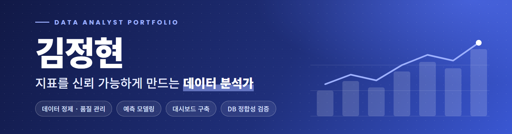

  
  
  
  

<table align="center">
  <tr>
    <td align="center" width="200"><h2>8</h2>수행 프로젝트</td>
    <td align="center" width="200"><h2>5개</h2>분석 도메인</td>
    <td align="center" width="200"><h2>1회</h2>프로젝트 대상 수상</td>
    <td align="center" width="200"><h2>Python · SQL</h2>핵심 도구</td>
  </tr>
</table>

## 👋 About

Raw data 가공과 EDA로 문제를 먼저 살피고, 의사결정에 쓸 수 있는 지표와 대시보드로 만드는 데이터 분석가입니다.  
공모전·해커톤·부트캠프에서 8개 프로젝트를 수행했고, 데이터톤 프로젝트로 대상을 받았습니다.

<table>
  <tr>
    <td width="50%" valign="top"><b>🧹 데이터 정제 · 품질 관리</b> 시간 표기 이상 48건 복원, 6,168시간 결측 0건 정제 317,455행 · 22열 통합 데이터셋과 4단계 이상치 기준 설계</td>
    <td width="50%" valign="top"><b>📈 예측 모델링</b> LSTM+TCN 앙상블 RMSE 8.67kW (기준선 대비 30.0% 감소) 15분 선행 예측 R² 0.907 ~ 0.969, 고혈압 AUC 0.9357</td>
  </tr>
  <tr>
    <td width="50%" valign="top"><b>📊 대시보드 구축</b> Dash 관제 화면, Tableau 물가지수 대시보드, Streamlit 예측 서비스</td>
    <td width="50%" valign="top"><b>🗄️ DB 정합성 검증</b> API 명세와 분석 데이터 1:1 대조 후 AWS RDS 적재 Supabase 표 10개·RLS 설계, DB 통합 시험 167개 검증</td>
  </tr>
</table>

## 🧠 Skills

**주력**  

**보조**  

## 💼 Projects

<table>
  <tr>
    <td width="50%" valign="top"><b>01 · StockPilot</b> 부트캠프 · 2026.10 재고 소진일·입고 예정일로 위험 상품을 판정하는 웹 ▸ 가상 시나리오 20개 중 7개 검출 (기존 규칙 1개)</td>
    <td width="50%" valign="top"><b>02 · K-AI 제조데이터</b> 공모전 · 2026.09 1시간 뒤 전력 예측과 피크 사전경보 관제 화면 ▸ RMSE 8.67kW, 기준선 대비 30.0% 감소</td>
  </tr>
  <tr>
    <td valign="top"><b>03 · 변압기 예지보전</b> 부트캠프 · 2026.09 변압기 상태 15분 후 예측과 예지보전 대시보드 ▸ 15분 선행 R² 0.907 ~ 0.969</td>
    <td valign="top"><b>04 · 서울시 전통시장</b> 공모전 · 2026.04 전통시장 물가 대시보드와 활성화 정책 제안 ▸ 317,455행 정제, 물가지수 대시보드 단독 구현</td>
  </tr>
  <tr>
    <td valign="top"><b>05 · KSPO 장애인 체육</b> 공모전 · 2025.08 장애인 체육 시설·종목 편중 분석과 맞춤 추천 앱 ▸ Cramér's V 0.417, AWS RDS 적재</td>
    <td valign="top"><b>06 · 부산 DIVE 해커톤</b> 해커톤 · 2025.07 카드 결제 데이터로 본 소비 불균형과 상권 전략 기획 ▸ 소비 집중도 지수 설계, K-means 상권 구분</td>
  </tr>
  <tr>
    <td valign="top"><b>07 · 만성질환 예측</b> 🏆 부트캠프 · 2024.12 다중 질환 예측과 Streamlit 대시보드 ▸ <b>프로젝트 대상 수상</b>, 고혈압 AUC 0.9357 <a href="https://github.com/jhk4308/health-survey-disease-prediction">GitHub repo ↗</a></td>
    <td valign="top"><b>08 · 백화점 고객 예측</b> 부트캠프 · 2024.10 구매 패턴으로 고객 결혼 여부를 예측 ▸ Kaggle Private Score 0.741859 <a href="https://github.com/jhk4308/department-store-marriage-prediction">GitHub repo ↗</a></td>
  </tr>
</table>

각 프로젝트의 문제, 접근, 결과는 **[포트폴리오 ↗](https://jhk4308.github.io/#projects)** 에서 자세히 볼 수 있습니다.

## 🎓 Training & Education

| 기간 | 내용 |
|---|---|
| 2026.08 ~ 2026.11 | LS Jumpup AI 데이터 분석 부트캠프 (진행 중) |
| 2024.08 ~ 2025.01 | 멋쟁이사자처럼 데이터 분석 3기 부트캠프 수료 |
| 2017.03 ~ 2024.02 | 강원대학교 불어불문학과 졸업, 정보통계학과 복수전공 |
| 자격 | ADsP 최종합격, 사회조사분석사 2급·정보처리기사 필기합격 |

  

